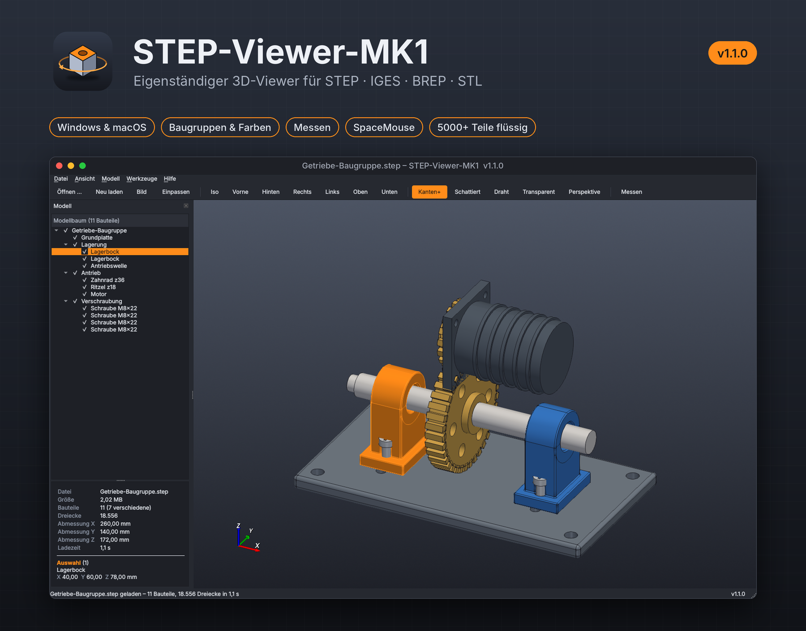

# STEP-Viewer-MK1



Eigenständiger 3D-Viewer für CAD-Dateien – angelehnt an den STEP-Viewer aus dem
3Dconnexion-Treiber. Kein Browserprogramm, sondern ein eigenes Programmfenster
(Qt + VTK, Geometrie über Open CASCADE).

**Version:** siehe `stepviewer/__init__.py` (aktuell 1.1.0)

## Funktionen

- Öffnet **STEP** (.stp/.step), **IGES** (.igs/.iges), **BREP** und **STL**
- Übernimmt Baugruppenstruktur, Bauteilnamen und Farben (auch Farben einzelner Flächen)
- Modellbaum mit Häkchen zum Ein-/Ausblenden, Mehrfachauswahl, „Nur Auswahl anzeigen“
- Klick ins Modell wählt das Bauteil im Baum aus
- Darstellungen: Schattiert + Kanten, Schattiert, Drahtgitter, Transparent
- Standardansichten (Iso, Vorne, Hinten, Links, Rechts, Oben, Unten), Einpassen,
  Parallel-/Perspektivprojektion, Achsenkreuz, drei Hintergründe
- Messen: Abstand zwischen zwei Punkten (mit ΔX/ΔY/ΔZ)
- Info-Bereich: Abmessungen, Bauteilanzahl, Dreiecke, Abmessungen der Auswahl
- Bild der Ansicht als PNG speichern
- Drag & Drop, „Zuletzt geöffnet“, Öffnen per Doppelklick/„Öffnen mit“
- 3Dconnexion SpaceMouse (experimentell, direkt per HID)
- Gleiche Bauteile werden nur einmal vernetzt (schnell bei Normteilen)

## Beispieldateien

Im Ordner `beispiele/` liegen zwei STEP-Dateien zum Ausprobieren:

- `Getriebe-Baugruppe.step` – Getriebe mit Grundplatte, Lagerböcken, Welle, Zahnrädern, Motor und
  Schrauben in mehreren Unterbaugruppen (auf dem Bild oben zu sehen)
- `Halter-Baugruppe.step` – kleiner Winkel mit drei Schrauben

## Bedienung

| Aktion | Maus / Taste |
|---|---|
| Drehen | linke Maustaste ziehen |
| Verschieben | rechte oder mittlere Maustaste ziehen |
| Zoomen | Mausrad |
| Auswählen | Klick auf Bauteil (Strg = Mehrfachauswahl) |
| Einpassen / Auswahl einpassen | F / Shift+F |
| Iso / Vorne / Rechts / Oben | 0 / 1 / 3 / 7 (mit Strg: Gegenseite) |
| Darstellung | Strg+E, Strg+R, Strg+W, T (transparent), P (Perspektive) |
| Ausblenden / Nur Auswahl / Alle | H / I / Strg+Shift+A |
| Messen | M (Esc beendet) |
| Neu laden | F5 |

## Build über GitHub Actions

Der Workflow `.github/workflows/build.yml` läuft bei jedem Push auf `main`/`master`
(oder manuell) und erzeugt:

- `STEP-Viewer-MK1-<Version>-Windows-Setup.exe` – Installer (ohne Adminrechte)
- `STEP-Viewer-MK1-<Version>-Windows-portable.zip` – entpacken und `STEP-Viewer-MK1.exe` starten
- `STEP-Viewer-MK1-<Version>-macOS.dmg` und `.zip` – App für Apple Silicon (M1–M4)

Vor dem Packen lädt jede Build-Variante die Beispieldatei im Selbsttest
(`--selftest`). Am Ende wird automatisch ein GitHub-Release `v<Version>` erstellt.

**Neue Version:** `VERSION` in `stepviewer/__init__.py` erhöhen und einen Abschnitt
in `CHANGELOG.md` ergänzen – der Release-Text wird daraus übernommen.

### macOS-Hinweis

Die App ist nicht von Apple notarisiert. Beim ersten Start: Rechtsklick auf die App →
„Öffnen“, oder im Terminal:

```
xattr -dr com.apple.quarantine /Applications/STEP-Viewer-MK1.app
```

## Lokal starten (Entwicklung)

```
python -m venv .venv
.venv\Scripts\activate            # macOS: source .venv/bin/activate
pip install -r requirements.txt
python main.py beispiele/Halter-Baugruppe.step
```

## SpaceMouse

Unter *Werkzeuge → SpaceMouse verwenden* einschalten. Der Viewer liest das Gerät direkt
per HID aus. Belegt der 3Dconnexion-Treiber das Gerät exklusiv, zeigt die Statusleiste
das an – dann den Treiberdienst (3DxWare) beenden oder die Maus nutzen.
SpaceMouse-Tasten: links = Einpassen, rechts = Iso-Ansicht.
